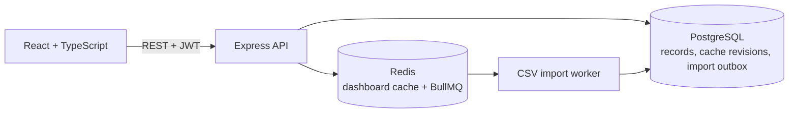

# FinSight

[](https://github.com/SaiSumedh18/finsight/actions/workflows/ci.yml)

A personal finance app (accounts, transactions, budgets, cash-flow dashboard) built to explore two backend problems: **keeping a cache correct when data changes**, and **importing files in the background without losing or duplicating data**.

**Live demo:** https://sai-finsight-demo.onrender.com — free hosting, so the first load can take about a minute to wake up. Create any account to try it.


## Engineering highlights

- **Cache that can't serve stale data after a write.** Dashboard results are cached in Redis under a key that includes a per-user *revision number*. PostgreSQL triggers bump that revision inside the same transaction as any financial write, so the next read always misses the old key. If Redis is down, requests fall back to PostgreSQL.
- **Background CSV imports with BullMQ.** Uploads (up to 10,000 rows) are accepted immediately and processed by a separate worker. The UI polls for status.
- **Idempotent imports.** Each upload carries an `Idempotency-Key`. Retrying the same file returns the original import. Reusing the key with different content returns `409 Conflict`.
- **No lost jobs.** The database acts as an outbox: an accepted import is saved first, so if Redis fails before queuing it, a dispatcher picks it up later. Transient failures retry with exponential backoff.
- **All-or-nothing.** A file commits in one transaction. An invalid row fails the whole import with no partial data.
- **Per-user isolation.** Every query is scoped to the authenticated user, and the worker re-checks account and category ownership.

## Architecture



## Results

Local load test with k6: 10,000 synthetic transactions, 10 concurrent users, 30 seconds per run.

| Mode | p50 | p95 | Requests/sec |
|---|---:|---:|---:|
| Cache off | 11.96 ms | 18.88 ms | 763 |
| Cache on (warm) | 1.62 ms | 3.12 ms | 5,236 |

This is one paired run on a laptop, not a production benchmark. Method and raw output: [engineering notes](docs/ENGINEERING_NOTES.md#measured-local-k6-comparison) and `benchmarks/results/`.

## Tech stack

| Area | Tools |
|---|---|
| Frontend | React, TypeScript, Vite, React Router |
| Backend | Node.js, Express, TypeScript |
| Data | PostgreSQL 16, Redis 7, BullMQ |
| Auth and security | JWT, bcrypt, Helmet, CORS, parameterized SQL |
| Testing | Vitest, Supertest (real PostgreSQL + Redis), k6 |
| Delivery | Docker Compose, Nginx, GitHub Actions |

## Run it locally

Requires Docker.

```bash
git clone https://github.com/SaiSumedh18/finsight.git
cd finsight
docker compose -f docker-compose.full.yml up -d --build
```

Open http://localhost:8080. This starts PostgreSQL, Redis, the API, the import worker, and the frontend behind Nginx.

For running services by hand, environment variables, the API reference, and the test database setup, see the [development guide](docs/DEVELOPMENT.md).

## Tests and CI

- 19 backend integration tests run against real PostgreSQL and Redis, covering auth, user isolation, balances, filtering, budgets, cache invalidation, idempotent imports, and failure recovery.
- GitHub Actions runs the tests, both builds, linting, Compose validation, and Docker image builds on every push.

## Known limits and next steps

- The cache still runs one small revision query per request, and writes for the same user are serialized on that revision row.
- Pending imports hold raw CSV text in the database. Production use would need encryption at rest and a retention policy.
- AWS deployment files (ECS, RDS, ElastiCache) are drafted in [`deploy/`](deploy/README.md) but not deployed.
- Next: recurring transactions, pagination for large histories, alerts for stuck imports.

## More screenshots

| Transactions | Budgets | Accounts |
|---|---|---|
|  |  |  |

---

Built by **Sai Sumedh Kaveti** · [Portfolio](https://saisumedhkaveti.work/) · [LinkedIn](https://www.linkedin.com/in/saisumedhkaveti/)
